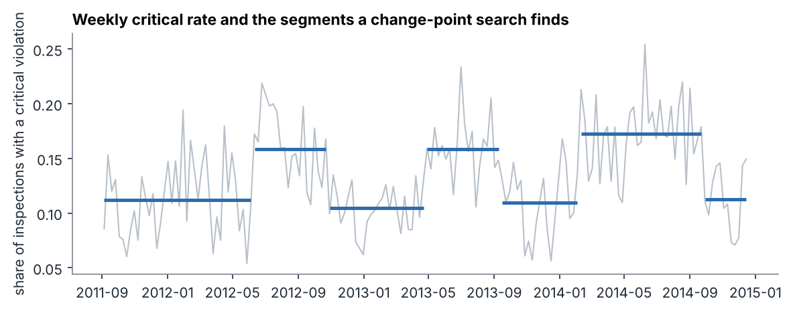
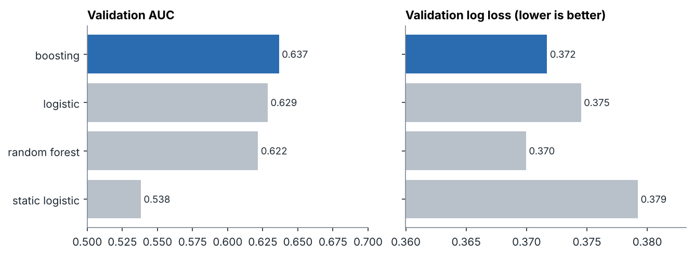
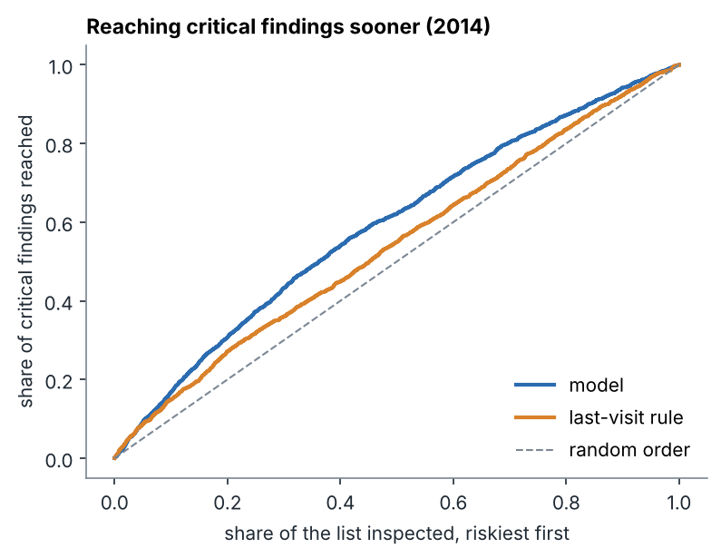
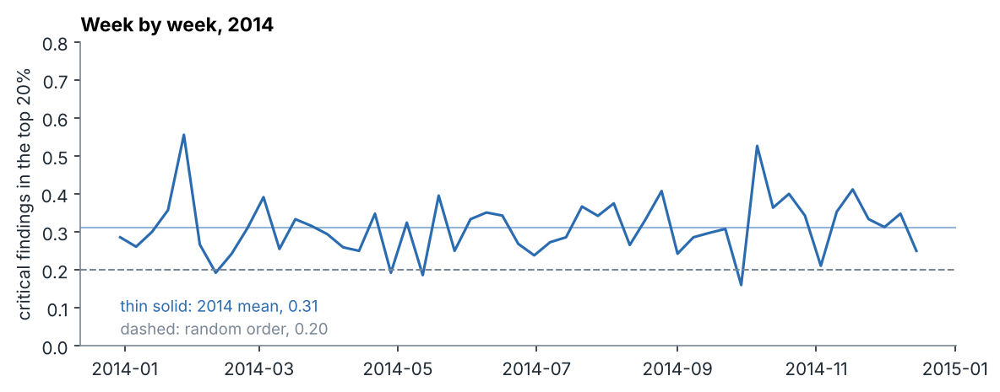
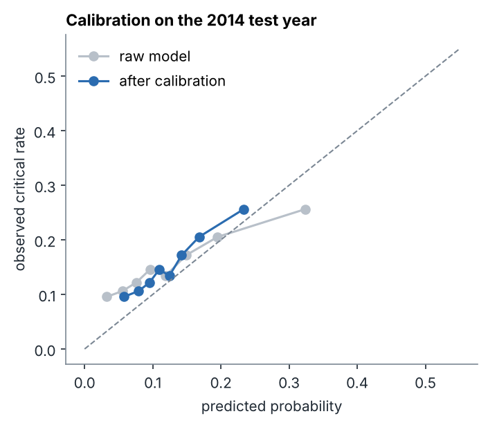
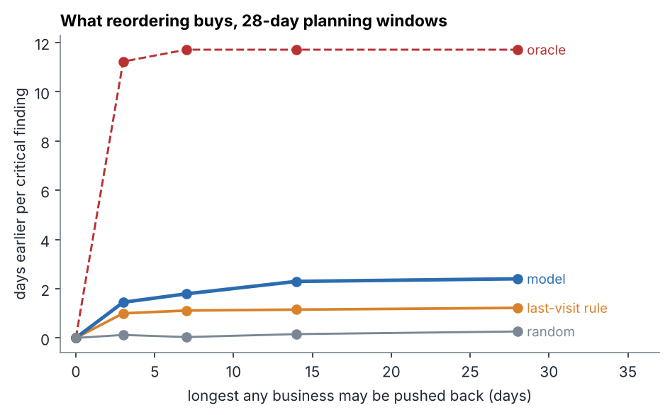
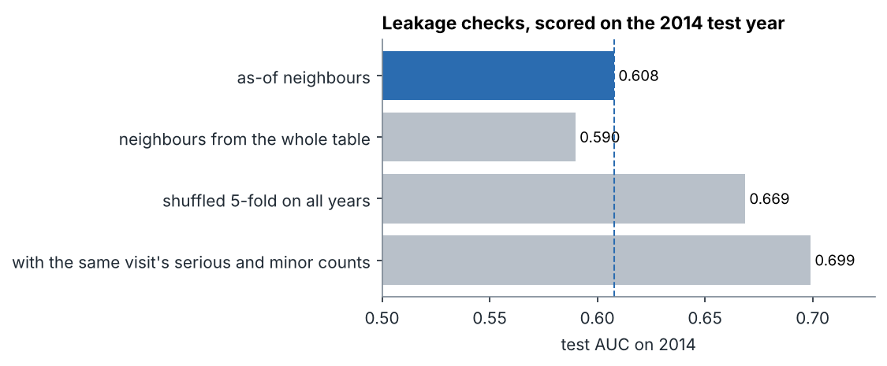
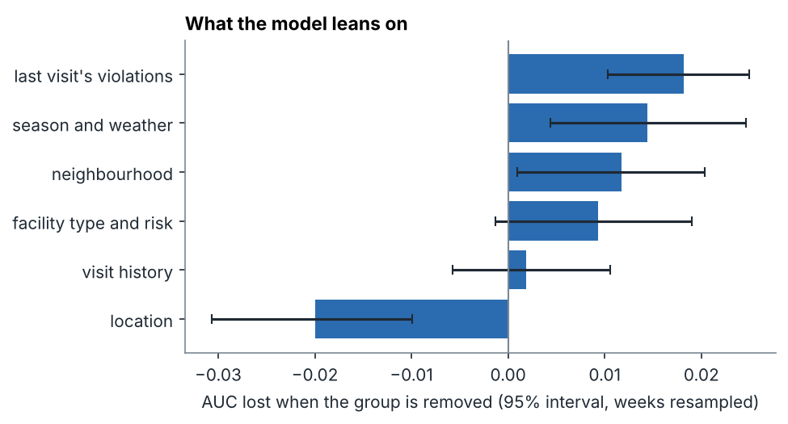
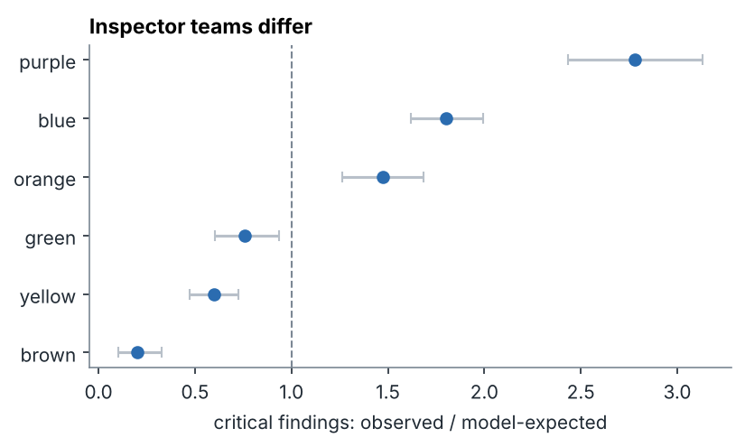

# kitchenrank

[](https://github.com/ranjithguggilla/kitchenrank/actions/workflows/ci.yml)

A food-safety inspector can only visit so many kitchens a day. This project ranks the inspections already on the calendar by how likely each one is to turn up a critical violation, then measures what happens if the calendar is reshuffled so the risky ones come first.

I used the City of Chicago's own published inspection data: 27,600 canvass inspections between September 2011 and December 2014. The model is deliberately modest (the held-out AUC is 0.61), and most of the repo is about checking that this modest number is honest: forward-in-time splits, history features that only look backwards, week-level bootstrap intervals, a calendar simulator with a fixed daily capacity, and a set of audits that found two things I did not expect (a raw-coordinates trap, and inspector teams whose critical-finding rates differ by more than ten times).

## Results

Everything below was produced by `kitchenrank` and is stored in `outputs/metrics.json` and `outputs/tables/`. The data is cut by date: 13,711 inspections up to 30 June 2013 for training, 4,112 up to the end of 2013 for validation and calibration, and the 9,777 inspections of calendar 2014 as the test year, scored once. The share of inspections with a critical violation was 12.4% in training, 12.6% in validation and 15.5% in the test year.

### What the raw table already says

Before any model: the critical rate climbs with every earlier critical finding, and it has a strong season.

| earlier critical violations at the previous visit | inspections | share with a critical violation |
|---|---|---|
| 0 | 25,706 | 12.9% |
| 1 | 1,183 | 18.9% |
| 2 or more | 711 | 27.1% |

By month the rate runs from 9.5% in November to 17.9% in July. Restaurants sit at 14.9% against 10.3% for other facility types, and the city's risk category 1 (highest) is at 14.6% against 10.4% and 9.4% for categories 2 and 3. A first visit on record is barely different from a repeat visit (13.9% against 13.2%).



A change-point search over the weekly rate finds seven segments. They line up with summers (15.8% to 17.2%) and winters (10.5% to 11.3%) rather than with a lasting shift, so I treated the pattern as seasonal and gave the model the month and the day's weather.

### Choosing a model

Four models were trained on the training block and compared on the validation block. A fifth, boosting with class weights, is there only to show what reweighting costs.

| model | AUC | log loss | ECE | recall in top 20% | weekly NDCG@10 |
|---|---|---|---|---|---|
| static logistic (risk, restaurant flag) | 0.538 | 0.379 | 0.019 | 0.264 | 0.123 |
| logistic | 0.629 | 0.375 | 0.034 | 0.355 | 0.257 |
| random forest | 0.622 | 0.370 | 0.021 | 0.337 | 0.255 |
| boosting | 0.637 | 0.372 | 0.028 | 0.335 | 0.252 |
| boosting, class-weight balanced | 0.635 | 0.606 | 0.293 | 0.339 | 0.239 |

The random forest has the lowest validation log loss (0.3700). The rule I wrote down beforehand was to take the simplest of logistic, boosting and forest whose log loss is within one bootstrap standard error of the best, with the standard error taken from resampling weeks. Logistic misses that bar (gap 0.0045 against an error of 0.0022), boosting clears it (gap 0.0017 against 0.0030), so boosting was chosen. Class weighting leaves the ranking alone and wrecks the probabilities (ECE 0.293), so I did not use it.



I should be plain about one thing. Once the test year was scored, plain logistic regression did a little better than the chosen boosting model on AUC (0.621 against 0.608) and about the same on recall in the top 20% (0.329 against 0.307). I did not swap the model after seeing that, since the choice was made on validation. The two are close enough that the practical advice is to use whichever one is easier to maintain.

### The 2014 test year

The chosen model, calibrated on the validation block, against two baselines: a manager's rule (inspect first whoever had critical violations last time, tie-break by a failed result) and a random order. Intervals come from resampling whole weeks, 400 times, because inspections in one week share a schedule and a season.

| | model | last-visit rule | random order |
|---|---|---|---|
| AUC | 0.608 [0.591, 0.623] | 0.551 [0.533, 0.569] | 0.507 [0.489, 0.525] |
| critical findings in the top 10% of the list | 0.167 [0.152, 0.184] | 0.149 [0.136, 0.164] | 0.104 [0.088, 0.118] |
| critical findings in the top 20% | 0.307 [0.288, 0.329] | 0.271 [0.250, 0.289] | 0.200 [0.181, 0.219] |
| critical findings in the top 30% | 0.433 [0.408, 0.458] | 0.360 [0.341, 0.382] | 0.292 [0.267, 0.316] |
| lift in the top 20% | 1.53 | 1.36 | 1.00 |



Treating each calendar week as a query (with `ranx`) gives a more mixed picture:

| weekly ranking metric | model | last-visit rule | random order |
|---|---|---|---|
| NDCG@10 | 0.265 | 0.279 | 0.156 |
| precision@10 | 0.267 | 0.247 | 0.165 |
| MAP@50 | 0.119 | 0.110 | 0.063 |
| reciprocal rank of the first critical finding | 0.486 | 0.580 | 0.302 |

At the very top of a weekly list, the simple rule is as good as the model, and it finds the first critical case a little sooner. The model earns its keep further down the list, where a rule has nothing left to say, and that is where a department short of inspectors actually operates.



### Calibration and risk bands

The test year ran hotter than the years the model learned from (15.5% against 12.4%). A sigmoid recalibration, fitted on the validation block, was kept because it beat leaving the scores alone by more than one standard error on the later half of that block. On the test year it moved log loss from 0.435 to 0.426 and ECE from 0.041 to 0.028. The average predicted probability in the test year is 12.6% against an observed 15.5%, so the frozen model still runs about three points low, which is what a hotter year looks like to a model that cannot see the next one.



The bands used by the app are quantiles of the test-year scores, and the observed rates behave:

| band | share of list | inspections | observed critical rate |
|---|---|---|---|
| lower than usual | bottom 40% | 3,911 | 11.0% |
| about usual | next 30% | 2,933 | 14.6% |
| elevated | next 20% | 1,955 | 20.5% |
| high | top 10% | 978 | 25.9% |

### Reordering the calendar

This is the part that matters operationally. The real calendar fixes how many inspections happen on each day. A policy may only change which businesses fill those slots. I simulated that over 28-day planning windows with two heaps: a max-heap on risk score for the free choice, and a min-heap on deadlines so that no business is pushed back more than a set number of days. Moving visits around a fixed calendar cannot create days, so any gain for a risky business is paid for by others waiting a little longer, and the test suite checks that the totals balance in every window.

The headline setting lets a business wait at most 7 days beyond its real visit. A critical finding is then reached 1.79 days earlier on average (95% interval 1.28 to 2.29, from resampling planning windows). Across the 1,512 inspections in 2014 that had a critical violation, that adds up to 2,708 violation-days that did not happen. The 8,265 inspections without a critical violation waited 0.33 days longer on average.

| most any business may be pushed back | model | last-visit rule | random order | perfect foresight |
|---|---|---|---|---|
| 0 days | 0.00 | 0.00 | 0.00 | 0.00 |
| 3 days | 1.45 | 1.00 | 0.12 | 11.23 |
| 7 days | 1.79 | 1.11 | 0.04 | 11.71 |
| 14 days | 2.30 | 1.15 | 0.15 | 11.71 |
| 28 days | 2.40 | 1.22 | 0.26 | 11.71 |

Days earlier per critical finding, 28-day windows. The planning window matters as much as the delay cap: at a 7-day delay cap the model gains 0.70 days with 7-day windows, 1.20 with 14-day windows and 1.79 with 28-day windows. The perfect-foresight column is an upper bound that no real model reaches, and it shows how little of the available gain a 0.61 AUC captures.



The simulation assumes every inspection in a window is on the due list 28 days ahead of its real visit. The real process has due dates the data does not show, so read these as what a planner could reach if the list were that flexible.

### What it is worth

There are two ways to value this, and only one of them rests on a number I had to assume.

Visits. If a department wants to find half of the critical cases and works through the list from the top, the model reaches that point after 36.2% of the list, the last-visit rule after 45.1%, and a random order after 49.7%. On the 9,777-inspection test year that is 1,320 fewer visits than a random order. At an assumed loaded cost of $150 per visit (inspector time, travel and admin; change `visit_cost` in `config.py`), that is $198,000. Put the other way, the top 30% of the model's list contains 22.3 critical findings per 100 visits against 15.5 for a random 30%.

Exposure days. The 2,708 avoided violation-days are measured, but putting a dollar value on a day of a critical violation is not something this data can do. The table below only multiplies the measured days by three stated values, to show the scale.

| assumed value of one avoided violation-day | value over the 2014 test year |
|---|---|
| $0.50 | $1,354 |
| $2.00 | $5,416 |
| $5.00 | $13,540 |

The honest reading is that reordering costs no extra visits, so any positive value is a gain, but the exposure-day gain alone is small unless a day of a critical violation is worth far more than a few dollars. The visit saving is the larger and sturdier number.

### Audits

Leakage. Three ways to fool myself, each scored on the same test year.

| variant | test AUC |
|---|---|
| as-of neighbours (the one I use) | 0.608 |
| neighbours counted from the whole table, past and future | 0.590 |
| shuffled 5-fold over all three years | 0.669 |
| adding the same visit's serious and minor counts | 0.699 |

Shuffled folds overstate the score by 0.06, and a careless join of same-visit counts by 0.09. I expected the future-neighbours variant to inflate the score too, and it did not: it is lower, probably because an all-time neighbourhood rate is smoother and less current than a 180-day trailing one.



History features were checked against the columns the city shipped with its own table: the first-visit flag agrees on 99.97% of rows and the previous-failure flag on 99.99%.

Feature groups. I dropped each group of columns, refitted, and measured the test-year AUC change with a paired week bootstrap.

| dropped group | AUC lost | 95% interval |
|---|---|---|
| last visit's violations | 0.018 | 0.010 to 0.025 |
| season and weather | 0.014 | 0.004 to 0.025 |
| neighbourhood | 0.012 | 0.001 to 0.020 |
| facility type and risk | 0.009 | -0.001 to 0.019 |
| visit history | 0.002 | -0.006 to 0.011 |
| location (raw latitude and longitude) | -0.020 | -0.031 to -0.010 |

Raw coordinates hurt. Removing them lifts the test-year AUC from 0.608 to 0.628. On the validation block the same drop looked harmful (AUC down 0.013, interval -0.003 to 0.028), which is the whole problem: the value of raw coordinates changes sign between periods. The rule I fixed in advance drops a group only if removal helps on validation with the whole interval above zero, so the coordinates stayed in. I report the flip rather than quietly acting on the test year. The next refit should drop them or replace them with a coarser area code.



Inspector teams. The assignment file colour-codes the sanitarian on each visit (available for 4,645 of the 2014 inspections). Against the rate the model expected, the observed share of critical findings runs from 0.20 times for the brown team to 2.78 times for the purple team.

| team | inspections | observed rate | model-expected rate | observed over expected |
|---|---|---|---|---|
| brown | 448 | 2.2% | 11.1% | 0.20 |
| yellow | 790 | 7.6% | 12.7% | 0.60 |
| green | 1,000 | 10.4% | 13.7% | 0.76 |
| orange | 980 | 15.0% | 10.2% | 1.47 |
| blue | 1,155 | 22.4% | 12.5% | 1.80 |
| purple | 272 | 43.0% | 15.5% | 2.78 |

A chi-square test of equal rates gives 325 on 5 degrees of freedom. Adding the team as a feature lifts AUC on those rows from 0.598 to 0.716, which looks like a win and is not one: it would teach the model who is inspecting, not which kitchen is dirty. The data cannot say whether the gap is strictness, different assigned neighbourhoods or different premises, so I left the team out of the model and flag it as the biggest open question about the labels.



Refit cadence. A model refitted at the start of each 2014 quarter on everything before it scored AUC 0.635 and caught 34.7% of critical findings in the top 20%, against 0.608 and 30.7% for the frozen model. Retraining quarterly is worth doing.

City extras. About two thirds of rows carry business-licence flags, business age and crime and sanitation-complaint heat values. On those rows (4,028 in the test year) adding them lifted AUC from 0.570 to 0.585, a gain of 0.014 with an interval of 0.004 to 0.026. Small, but not zero. The main model leaves them out so that every inspection can be scored.

## Architecture

```
  data/inspections.csv.gz
            |
            v
   data.load_inspections ----> split by date: train | validation | test (2014)
            |
            v
   features.build_features        history (earlier days only), previous visit's
            |                     violation codes, as-of neighbourhood rate (BallTree),
            |                     calendar and weather
            v
   models.make_model  ---->  evaluate.compare_models  ---->  one-SE rule picks the model
            |                                                          |
            |                                   evaluate.choose_calibrator (validation block)
            v                                                          |
      frozen model + calibrator  <-------------------------------------+
            |
            +--> evaluate.report_block ...... week-bootstrap metrics, ranx weekly ranking
            +--> evaluate.leak_audit, family_ablation, inspector_audit, refits, extras
            +--> schedule.simulate .......... two heaps: score and deadline, per planning window
            +--> economics ................. visits to reach half the cases, exposure days
            |
            v
   outputs/metrics.json, outputs/tables/*.csv, assets/*.png, outputs/bundle.joblib
                                                                |
                                                                v
                                                  score.score_visit  ->  app.py (Gradio)
```

## Installation

Python 3.12 or newer. Developed on 3.13.

```bash
git clone https://github.com/ranjithguggilla/kitchenrank.git
cd kitchenrank
python -m venv .venv && source .venv/bin/activate
pip install -r requirements.txt
pip install -e . --no-deps
```

For tests and linting use `requirements-dev.txt` instead. Rebuilding the CSV from the city's repository also needs `pip install rdata`.

## Usage

1. Run the whole study. It takes about two minutes on a laptop and is deterministic: two runs produce byte-identical metrics.

   ```bash
   kitchenrank
   ```

   Add `--quick` for a run with 60 bootstrap draws instead of 400.

2. Look at `outputs/metrics.json` for every number quoted above and `outputs/tables/` for the CSVs behind the tables.

3. Start the scoring app. It loads `outputs/bundle.joblib`, which step 1 writes.

   ```bash
   kitchenrank-app
   ```

   Describe a scheduled visit (risk category, earlier visits, what the last visit found, the month and the temperature) and it returns a probability, a band and up to three plain-language reasons.

4. Check that a fresh run reproduces the committed numbers:

   ```bash
   cp outputs/metrics.json /tmp/committed.json
   kitchenrank
   python -m kitchenrank.verify /tmp/committed.json outputs/metrics.json
   ```

5. To rebuild the data file from the source repository:

   ```bash
   git clone --depth 1 https://github.com/Chicago/food-inspections-evaluation.git
   python -m kitchenrank.ingest food-inspections-evaluation/DATA data/inspections.csv.gz
   ```

## Configuration

Everything adjustable is in `src/kitchenrank/config.py`.

| setting | default | meaning |
|---|---|---|
| `TRAIN_END`, `VALID_END` | 2013-06-30, 2013-12-31 | block boundaries; the test block is everything after |
| `NEIGHBOUR_RADIUS_M` | 600 | how close counts as a neighbour |
| `NEIGHBOUR_WINDOW_DAYS` | 180 | how far back neighbours are looked up |
| `NEIGHBOUR_PRIOR_STRENGTH` | 8 | pseudo-visits that pull a sparse area toward the city rate |
| `HORIZONS`, `MAX_DELAYS` | 7, 14, 28 and 0 to 28 days | planning windows and delay caps in the scheduling grid |
| `HEADLINE_HORIZON`, `HEADLINE_MAX_DELAY` | 28, 7 | the setting quoted as the headline |
| `N_BOOT` | 400 | week-bootstrap draws |
| `COSTS.per_exposure_day` | 0.5, 2, 5 | assumed dollar values of one avoided violation-day |
| `COSTS.visit_cost` | 150 | assumed loaded cost of one inspection visit |
| `SEED` | 7 | seed for every model and resample |

## Output structure

```
outputs/
  metrics.json                    every headline number
  bundle.joblib                   frozen model, calibrator and defaults for the app (git-ignored)
  tables/
    validation_models.csv         model comparison on the validation block
    test_models.csv               the same models on the test year
    calibration_choice.csv        identity, sigmoid and isotonic on the later half of validation
    risk_bands.csv                observed rate per band
    family_ablation.csv           test-year ablation
    validation_family_ablation.csv   the ablation used for the pruning rule
    inspector_audit.csv           observed over expected per team
    schedule_grid.csv             every policy, planning window and delay cap
    value_table.csv               avoided violation-days at the assumed values
assets/                           the charts in this README
```

## Project structure

```
src/kitchenrank/
  config.py       paths, split dates, neighbour settings, cost assumptions
  data.py         loading, validation, forward-in-time blocks
  ingest.py       builds the CSV from the city's R data files (optional)
  features.py     as-of history, previous-visit codes, neighbourhood, calendar, weather
  models.py       logistic, random forest and boosting pipelines
  metrics.py      AUC, calibration error, recall and lift, week bootstrap
  ranking.py      weekly ranking quality through ranx
  evaluate.py     model choice, calibration, leak audit, ablations, inspector audit, refits
  schedule.py     the two-heap calendar simulator
  economics.py    visits to reach a target share, value of avoided violation-days
  score.py        scoring one visit and the plain-language reasons
  app.py          Gradio front end
  plots.py        README charts
  pipeline.py     runs everything and writes the outputs
  verify.py       compares two metrics files
tests/            pytest suite
data/             vendored inspection table
```

## Technical details

Label. A visit counts as positive when it found at least one violation under codes 1 to 14 of the city's inspection form, the ones the city treats as critical. The tests check that the critical count in the table equals the sum of those 14 code columns on every row.

History. For each visit the features come from the same licence's visits on strictly earlier days: the number of earlier visits, days since the last one, the last visit's critical, serious and minor counts and result, the share of earlier visits with a critical finding, a trailing three-visit rate, the number of distinct critical codes ever cited, and the 44 per-code flags of the last visit. Two visits on the same day do not see each other. A test changes the last row of a table and checks that no earlier row's features move.

Neighbourhood. For each week a BallTree over the previous 180 days of inspections (haversine metric) returns the inspections within 600 metres, excluding the same licence. The rate is smoothed toward the training-block rate with eight pseudo-visits. The training rate is passed in as a constant, so a scored row never contributes to its own smoothing.

Models. Logistic regression with median imputation and scaling, a random forest with a median imputer, and histogram gradient boosting with native missing-value handling, depth 4 and early stopping. All preprocessing sits inside the pipeline.

Intervals. Metrics are resampled by calendar week, 400 draws, because inspections within a week are not independent. Paired differences resample the same weeks for both arms.

Scheduler. For each planning window the simulator walks the real inspection days in order. On each day it first fills the real capacity from a min-heap of deadlines (anyone whose delay cap has arrived), then from a max-heap of scores. Entries are removed lazily. If a window cannot be satisfied the overflow count is reported; it was zero in every run here.

Reasons in the app. Each group of columns is swapped for the typical training value in turn, and the drop in probability is reported for the three groups that move it most, with the actual values written out.

## Testing

```bash
pip install -r requirements-dev.txt
pip install -e . --no-deps
ruff check src tests
pytest -q --cov=kitchenrank --cov-report=term-missing
```

61 tests, 94% line coverage. They cover the as-of guarantees (a changed future row never changes an earlier feature, same-day visits are blind to each other), the neighbourhood modes, the model-choice rule on tied and clearly separated models, the calibrator choice, the heap scheduler (capacity preserved, delay cap respected, totals balanced inside each window), the bootstrap, the economics arithmetic, the scoring function behind the app, every chart, the metrics comparison script and a full run of the pipeline on a synthetic table. The vendored data file is also checked for unique ids, date order and the code-sum identity.

CI on GitHub runs the same lint and tests on every push and pull request. On main it also reruns the full pipeline, compares the headline numbers with the committed `metrics.json` and uploads the outputs as an artifact.

## Dataset

The inspection records, violation matrix, licence flags, weather and inspector assignments come from the City of Chicago's food-inspections-evaluation repository, https://github.com/Chicago/food-inspections-evaluation, which publishes the data behind the city's own predictive inspection pilot. The underlying inspection records are from the Chicago Data Portal. The repository is released under an MIT-style licence, Copyright 2014 City of Chicago. `data/inspections.csv.gz` is a flat extract of its `.Rds` tables, produced by `kitchenrank.ingest`.

The extract has 27,600 canvass inspections of 12,367 licences. It is not every Chicago inspection (complaint and licence inspections are not in the table), so the results describe routine canvass scheduling.

## License

MIT, see `LICENSE`.
